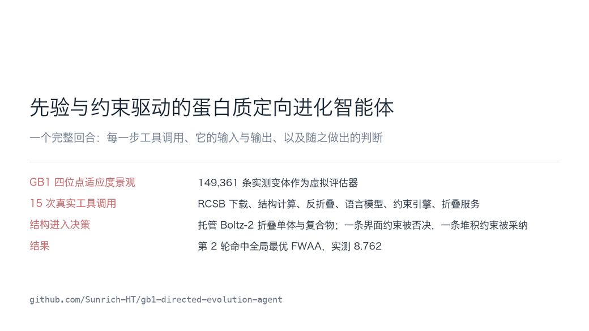
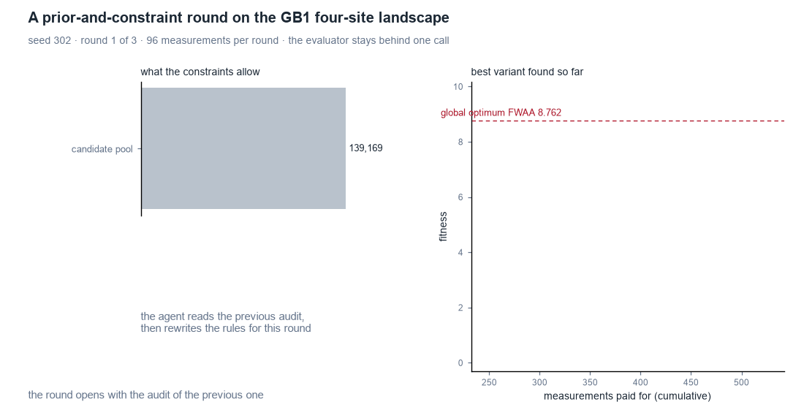
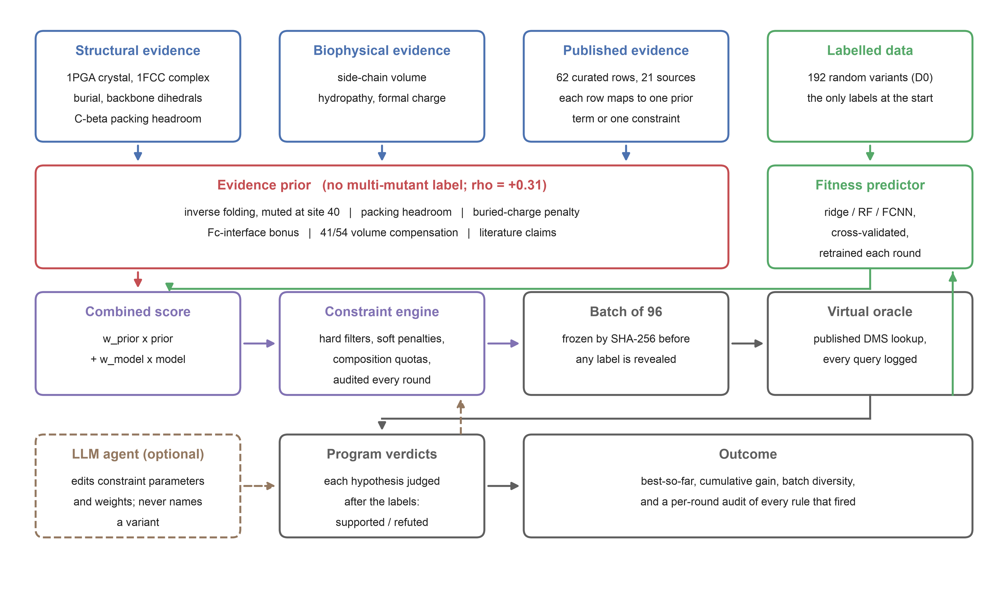

# GB1 Directed-Evolution Agent

[](https://github.com/Sunrich-HT/gb1-directed-evolution-agent/actions/workflows/tests.yml)
[](pyproject.toml)
[](LICENSE)

A directed-evolution agent for the GB1 four-site fitness landscape, built as a
**controlled comparison of seven batch-selection strategies** that share one starting
set of 192 labels and one budget of 3 × 96 measurements.

The question is narrow on purpose: *before any multi-mutant label exists, how much can
structures, physical chemistry and published literature tell you — and does a language
model add anything on top of that?*

**Headline result.** The evidence prior and the explicit constraints do the work: they
lift the rate of reaching the global optimum from **20 %** (3/15 seeds, predictor-greedy)
to **60 %** (9/15), paired McNemar *p* = 0.031. The language model adds nothing
measurable on top of them — freezing the rules changes nothing (Wilcoxon *p* = 1.000),
and used as a picker it reproduces greedy on 14 of 15 seeds.

### One complete round, step by step



Fifteen real tool calls: RCSB download, structural analysis, inverse folding, the
evidence prior, the predictor, the language model setting the rules, the constraint
engine, the frozen batch, the verdicts, and the hosted structure service — including
the docking check that **refused** an interface constraint and the packing relation
that was accepted instead. Same content as
[`demo/index.html`](demo/index.html), which plays through the steps in the browser;
[`figures/animation/case.mp4`](figures/animation/case.mp4) is the same walkthrough as video.



What each round does to the candidate pool: the hard filters cut 139,169 candidates
down to the legal set, 96 go to the evaluator under a SHA-256 commitment, and the
labels come back — the global optimum lands in round 2.

| | |
|---|---|
| Call-trace demo | [`demo/index.html`](demo/index.html) — one round's 15 tool calls, inputs and outputs, raw JSON expandable |
| One-shot recommender | `python scripts/recommend.py --top-k 10` |

The measured landscape is used as a **virtual evaluator**. No wet-lab experiment is
performed or claimed anywhere in this repository.

---

## The seven arms

| arm | what it does | final best (mean of 15 seeds) | hits the optimum |
|---|---|---|---|
| `random` | uniform sampling | 4.34 | 0/15 |
| `greedy` | predictor top-*k* | 7.60 | 3/15 |
| `greedy_explore` | 75 % greedy + 25 % random | 7.13 | 3/15 |
| `llm_agent` | LLM picks from the model's shortlist | 7.62 | 3/15 |
| `llm_knowledge` | same, plus a knowledge block | 7.60 | 3/15 |
| `prior_fixed` | evidence prior + constraints, rules frozen, **no LLM** | **8.03** | **9/15** |
| `prior_constraint` | the same, LLM may edit rule parameters each round | **8.07** | **9/15** |

Global optimum: FWAA, fitness 8.762.

## How it works

1. **Evidence prior** (`src/gb1agent/evidence.py`) — a 4 × 20 substitution table plus a
   site-pair term, summed from independently switchable components: inverse-folding
   log-odds (muted at site 40 on documented grounds), C-beta packing headroom, a
   buried-charge penalty, an IgG-Fc interface bonus, 41/54 volume compensation, and 62
   curated literature claims. It uses **no multi-mutant label** and still ranks variants
   as well as a prior built from measured single mutants (ρ = +0.295 vs +0.294 on the
   ≥3-mutation subset).
2. **Constraint engine** (`src/gb1agent/constraints.py`) — rules are data, not code
   branches: each declares an id, a kind (hard filter / soft penalty / composition quota),
   its parameters and its evidence. Every round emits an audit record: how many candidates
   each filter removed, whether each quota bound, and how many of the 96 slots changed
   relative to the same score without constraints.
3. **Knowledge graph** (`knowledge/knowledge_graph.json`, 666 nodes / 2124 edges) —
   `Position`, `AminoAcid`, `Mutation`, `Variant`, `Claim`, `Source`, related by
   `OCCURS_AT`, `HAS_PROPERTY`, `IMPROVES`/`HARMS`, `CONTAINS`, `SUPPORTS`/`REFUTES`,
   `COMPENSATES`. `IMPROVES`/`HARMS` edges use only labels the campaign already paid for.
4. **Program verdicts** (`src/gb1agent/interpret.py`) — hypotheses are judged by the
   program after the labels are revealed, not by the model; refuted substitutions become
   the next round's penalty term automatically.



## Quickstart

```bash
git clone https://github.com/Sunrich-HT/gb1-directed-evolution-agent
cd gb1-directed-evolution-agent
make install          # pip install -e .
make data             # fetch the landscape (checksum-verified) and 1PGA / 2GB1 / 1FCC
make test             # 7 unit tests
make recommend        # a ranked mutation proposal from the wild-type sequence
```

`make help` lists every target. `make all` runs everything that does not need an API key
(prior, baselines, analyses, significance tests, figures, demo page).

### Reproducing a single campaign

```bash
python scripts/run_experiment.py --data data/gb1_flip.zip \
    --arms random greedy prior_fixed --seeds 302
```

The two LLM-steered arms need `DEEPSEEK_API_KEY`; the structure work needs
`NVIDIA_API_KEYS`. Copy `.env.example` to `.env` and fill it in — `.env` is git-ignored
and no key is ever written to `results/`, where API calls are recorded by **key index**
only. A smoke test that needs no key at all:

```bash
python scripts/reproduce_small.py --data data/gb1_flip.zip
```

## Repository map

```
src/gb1agent/        data loading, features, predictors, evidence prior, constraint
                     engine, round protocol, verdicts, LLM client, CLI
scripts/             one entry point per step; every figure and every reported
                     number is produced by a script in here
knowledge/           evidence base (62 claims, 21 sources), structural evidence,
                     knowledge graph, references.bib
results/             committed on purpose: per-round prompts and raw replies, API
                     receipts, constraint audits, oracle query log, spend ledger
figures/paper/       every figure in the report, PDF + PNG + collision audit
demo/index.html      the call trace rendered as a page
tests/               unit tests (run in CI on 3.10 and 3.12)
vendor/proteinmpnn/  pinned upstream ProteinMPNN (MIT, its own LICENSE retained)
```

## Environment

Python ≥ 3.10; numpy, pandas, scipy, scikit-learn, matplotlib, requests, pillow
(`pyproject.toml`). Torch is needed only to recompute ProteinMPNN log-odds locally —
the committed `config/mpnn_log_odds.json` records the model version, the pinned commit
and the weight SHA-256, so the pipeline runs without it. The report is built with
XeLaTeX (CJK via `fontspec`).

## Data and provenance

| resource | source | how it is used |
|---|---|---|
| GB1 four-site DMS | FLIP benchmark, commit `62cace8`, SHA-256 verified in the loader | the virtual evaluator only |
| 1PGA / 2GB1 / 1FCC | RCSB, fetched on demand with receipts | solvent accessibility, dihedrals, interface burial, packing headroom |
| ProteinMPNN | soluble `v_48_002`, pinned commit, weight SHA-256 recorded | inverse-folding log-odds; muted at site 40 |
| Boltz-2 | NVIDIA hosted inference | monomer and complex folding; see appendix B of the report |
| DeepSeek-chat | API | sets each round's rules and weights; never names a variant |
| literature | 21 public sources | 62 structured claims with provenance and confidence |

About 6.6 % of the dataset's variants are imputed rather than measured; the report states
this and every other limitation.

## Citation

See [`CITATION.cff`](CITATION.cff).

## License

MIT, see [`LICENSE`](LICENSE). Vendored ProteinMPNN keeps its own licence in
`vendor/proteinmpnn/LICENSE`. The FLIP dataset and the RCSB structures are governed by
their own terms and are not redistributed here.
